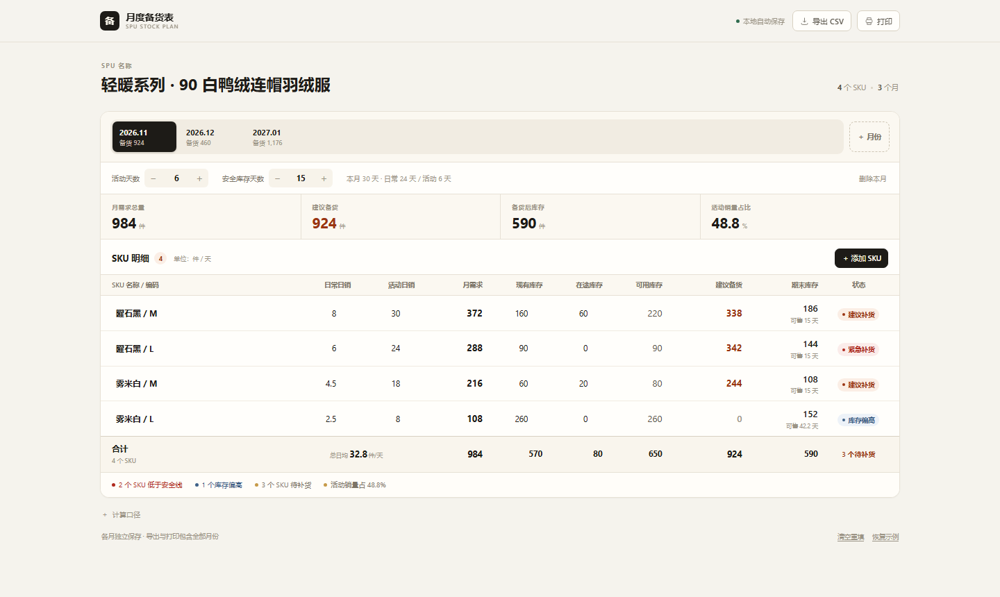

# SPU 月度备货表 · SPU Stock Plan

按**单个 SPU、多个 SKU** 做按月备货核算：一个月一个独立标签，分别填日常日销、活动日销、活动天数、安全库存和库存，自动算出每个 SKU 要备多少货。

线上使用：<https://bfsu1666935342-pixel.github.io/ecom-toolbox/tools/spu-stock-plan/>

打开 `index.html` 即可使用，纯本地、不联网、无依赖。



## 功能

- **每月独立**：每个月单独设置活动天数、安全库存和每个 SKU 的日销 / 库存，互不影响
- **月份标签**：标签上直接显示该月备货总量，方便多月横向对比
- **自动续接**：新增月份复制上月日销，并把上月期末库存作为下月期初库存
- **自动核算**：月需求、建议备货、期末库存、可售天数、库存状态一次算出
- **总日均**：合计行显示所有 SKU 加总后的整体日均销量
- **批量操作**：添加 / 删除 SKU、删除月份均支持撤销
- **导出与打印**：CSV 和打印 / PDF 都包含全部月份
- **本地保存**：数据自动存在浏览器 `localStorage`，不上传服务器

## 输入

顶部选择月份后，按月填写：

| 参数 | 说明 |
| --- | --- |
| 活动天数 | 当月做活动的天数，不能超过当月自然天数 |
| 安全库存天数 | 目标期末库存 = 日均销量 × 安全库存天数 |
| 日常日销 | 非活动期每个 SKU 的日均销量 |
| 活动日销 | 活动期每个 SKU 的日均销量；不参加活动的 SKU 填 0 |
| 现有库存 / 在途库存 | 可用库存 = 现有库存 + 在途库存 |

## 计算口径

```text
月需求   = 日常日销 ×（月天数 − 活动天数）+ 活动日销 × 活动天数
建议备货 = max(0, 月需求 + 日均销量 × 安全库存天数 − 现有库存 − 在途库存)
期末库存 = 可用库存 + 建议备货 − 月需求
可售天数 = 期末库存 ÷ 日均销量
总日均   = 所有 SKU 月需求合计 ÷ 本月天数
         = 各 SKU 日均销量之和
```

建议备货向上取整。

## 状态判断

| 状态 | 规则 |
| --- | --- |
| 紧急补货 | 建议备货 > 0，且备货前可售天数 < 安全库存天数的 70% |
| 建议补货 | 建议备货 > 0 |
| 库存偏高 | 无需补货，且备货后可售天数 > 2 × 安全库存天数（且 > 30 天） |
| 库存健康 | 其余情况 |
| 暂无销量 | 当月需求为 0 |

## 使用说明

- 点击 `＋ 月份` 新增下一个月；`删除本月` 可以删掉当前月份，至少保留一个
- 点击 `＋ 添加 SKU` 增加 SKU；鼠标移到行尾的 `×` 删除该 SKU
- 底部「计算口径」有完整公式说明
- 导出 CSV 带 BOM，Excel 打开不乱码
- 换浏览器、清缓存会丢失数据，重要数据请导出 CSV / 打印留档

## 技术

- 单文件 HTML + 内联 CSS / 原生 JavaScript，无构建、无第三方依赖
- 约 63 KB
- `localStorage` 键：`spu-stock-plan-v2`

## 授权

[MIT](../../LICENSE) © 2026 bfsu1666935342-pixel
